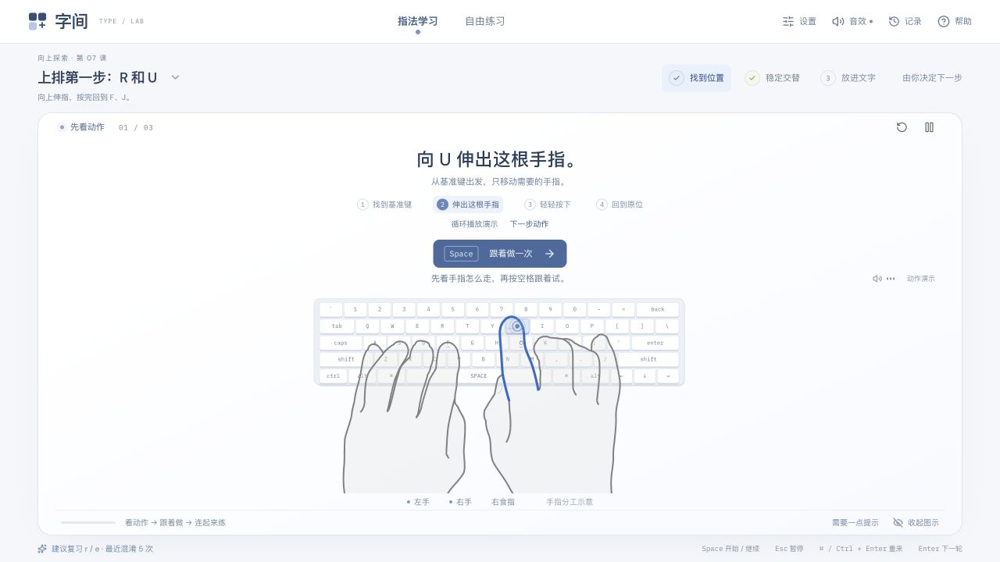

# 字间 Keyflow

纸白、雾蓝与深蓝的单画布打字课堂，取消独立的大字母卡，让键盘和双手示范成为中心。保留 30 节课程、90 轮递进练习、48 篇独立素材，教学提示、输入区和键盘始终围绕当前练习。



## 本地运行

需要 Node.js 22.13 或更新版本。

```bash
npm ci
npm run dev
```

打开 http://localhost:5173 。

```bash
npx tsc --noEmit
npm run build
```

当前项目使用 Vinext 与 Cloudflare Worker，GitHub 仓库用于保存源码，未配置 GitHub Pages。练习数据保存在使用者的浏览器中。

## 直接练习

每课第一轮先看手部动画，按 Space 进入逐键跟练：按对推进，按错停留并提示纠正路线，全部完成后等待 Space 进入整段练习。其余准备页按 Space 开始；第一下空格不写入原文。练习中的空格正常核对。暂停后按 Space 从原位置继续。指法学习显示动作与进度，自由练习显示速度、准确率和时间。顶部选择内容后自动定位输入区，下一轮等待 Space 开始。

每轮结果会一直保留，由使用者选择继续、重练或练错键。跟练结束和进入新一轮时也等待 Space，不自动开始。演示固定每步 1.5 秒循环；暂停后可直接选择任意动作步骤。

- Space：准备页开始、暂停页继续、成绩页进入下一轮。
- Enter：成绩页立即继续。
- R：成绩页重练。
- Esc：暂停输入 / 停留在成绩页；有弹窗时关闭弹窗。
- ⌘ / Ctrl + Enter：重新开始本轮。

指法提示在输入区下方更新。需要详细说明时点「帮助」，关闭后回到原来的输入位置。「记录」中可看错输、生成专项练习、导出与合并导入备份。

## 输入与学习辅助

默认按实体键位读取英文、代码和键位练习，不依赖输入法输出文字。使用中文输入法时同样可直接按 Space 开始、输入 F/J 等字母；采用美式 QWERTY 键位。中文练习保留系统输入法组合输入和候选确认，未确认的拼音不计分。触屏软键盘自动走系统输入，也可以在设置中手动选择系统输入。

课程卡片支持分章检索、直接复习指定阶段。三轮提示依次为完整双手、仅键位、独立输入，可一键恢复；连续三次错输会提供慢速演示。最近 30 轮的错键按近期频率生成对照练习，跟练错误参与建议但不计入正式成绩。

素材可按语言、难度、长度筛选并预览。自定义长文自动分段，位置与已输入文字保存在当前浏览器。设置中的字号、音量、引导程度、减少动态效果和输入方式会自动保留。

## 交互反馈

正确键是短促高音，错误键是较低的两次提示，完成一轮有单独提示音。声音由 Web Audio 即时合成，首次按空格或点击试听时启用；顶部静音状态会保存。在「帮助 → 手指分工」中可以选择按键、暂停与逐步查看动作；中文课演示拼音、候选确认和文字上屏。

## 数据

继续使用第一版与第二版的本地记录和课程进度，不删除原有存储。保存最近 120 轮成绩，数据只存在当前浏览器，不自动跨设备同步。自定义原文和分段位置不上传；通过 JSON 手动备份成绩与进度（不包含自定义文章和舒适度设置）。

中文按最终上屏文字核对，自由练习计时从按空格开始起算。网站不检测真实手指位置，示意候选确认流程，不检测输入法实际候选窗口。指法课建议使用实体键盘。

## 开发

`npm run dev` 启动本地开发，`npx tsc --noEmit` 检查类型，`npm run build` 构建。采用 Vinext、React 与 Sites 的 Cloudflare Worker 部署支持。

- `lib/curriculum.ts`：课程内容。
- `lib/library.ts`：原创练习素材。
- `lib/typing.ts`：计分与错输统计。
- `lib/workspace.ts`：续学、阶段衔接与数据校验。
- `components/typing-practice.tsx`：输入与连续练习引擎。

## 参考

操作流程研究了打字鸭的公开指法课程 https://daziya.com/courses/1/ ，参考其当前按键、手指提示与文字同屏的方式。界面与课程由本站自行实现。

视觉参考研究了 Landing Love、Landbook、Awwwards、One Page Love、Lapa Ninja、21st.dev 与 Siteinspire。手部采用现成 SVG 指法插画，以手势切换和轮廓高亮呈现对应手指，目标键、纠正路线与进度使用 CSS 动效；系统偏好减少动态效果时切换为静态步骤。

指法方法参考 Typing.com 的基准行课程 https://www.typing.com/student/lesson/134080/home-row-keys 。课程采用常见美式 QWERTY 分工，B 左食指、6 右食指，部分按键也存在其他习惯。

手部插画使用 [ayuday/vkeyboardhand](https://github.com/ayuday/vkeyboardhand) 的现成 SVG 手势素材（MIT），原始轮廓保持不变，许可证在 public/images/hands/LICENSE.txt。
